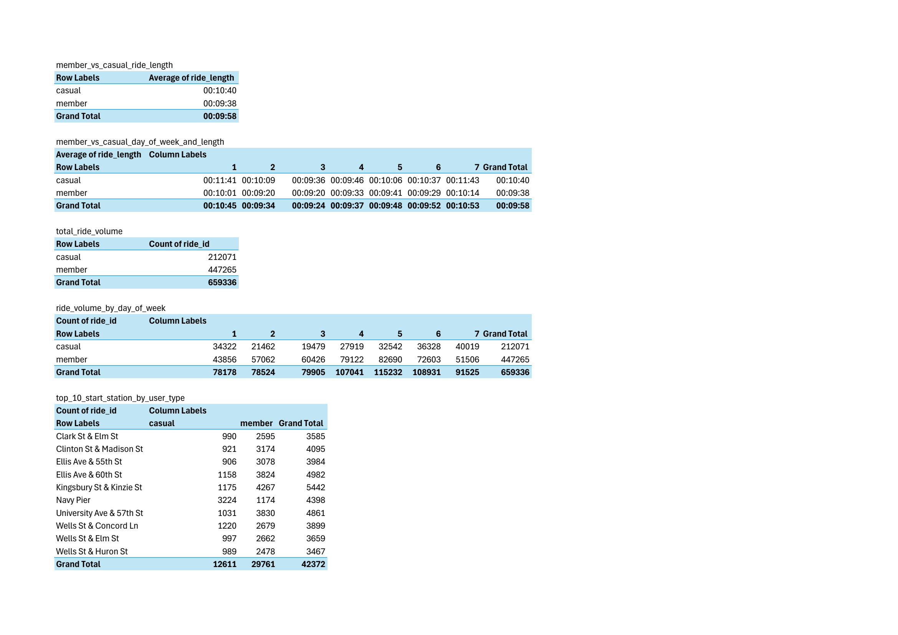

# Browsable data samples

## Files

| Folder | File | Description |
|---|---|---|
| `raw/` | `2025-04.csv` | Raw April 2025 sample |
| `raw/` | `2025-10.csv` | Raw October 2025 sample |
| `cleaned/` | `2025-04.csv` | Cleaned April 2025 sample |
| `cleaned/` | `2025-10.csv` | Cleaned October 2025 sample |

## Notes on interpreting the samples

- These are purely samples, and nowhere near the entire spreadsheet (which includes 600,000+ rows).
- The raw and cleaned excerpts are from the same named months, but not necessarily the same rows shown (as some would have been removed in the cleaning process.
- In the raw samples, `started_at` and `ended_at` appear as time-only values (for example, `29:34.6`). The date is not visible, though it is present which is how the `day of the week` columns were produced.
- Missing station values are represented as blank in the raw October excerpt and as `Missing` in the cleaned October excerpt.
  
## Reasoning for cleaning
- **Removing rows**: In April, only rows with start and end station IDs in the TA/KA format were kept. Rows with other ID formats (such as numeric IDs like 15642, or SL-/WL- codes) and rows with blank stations were removed, as they were harder to trace to a station. Together with outlier removal, this reduced April from 371,341 rows to 58,441, so April makes up about 9% of the cleaned data and the findings mainly reflect October. In October, blank stations were filled with “Missing” instead, so only outliers were removed.
- **Fixing time formatting**: Start and end times were displayed as minutes and seconds only (e.g. 29:34.6), hiding the hour and date, so they were reformatted to show the full time in 24-hour format.
- **Latitude and longitude**: In October, coordinates were rounded to 4 decimal places (about 11 metres), giving a standard format without losing meaningful accuracy. In April, they were formatted to display 4 decimal places. In both months, hidden apostrophes at the start of some values were removed, as they made Excel treat the coordinates as text, not numbers.
- **Filling blanks in**: In October, blank station values were replaced with “Missing”, so the rest of the row could still be used. This doesn’t affect the ride length and weekday calculations, and “Missing” was excluded from the station rankings.

## Combined data and PivotTables
 
- These tables were produced from combined April and October data.

