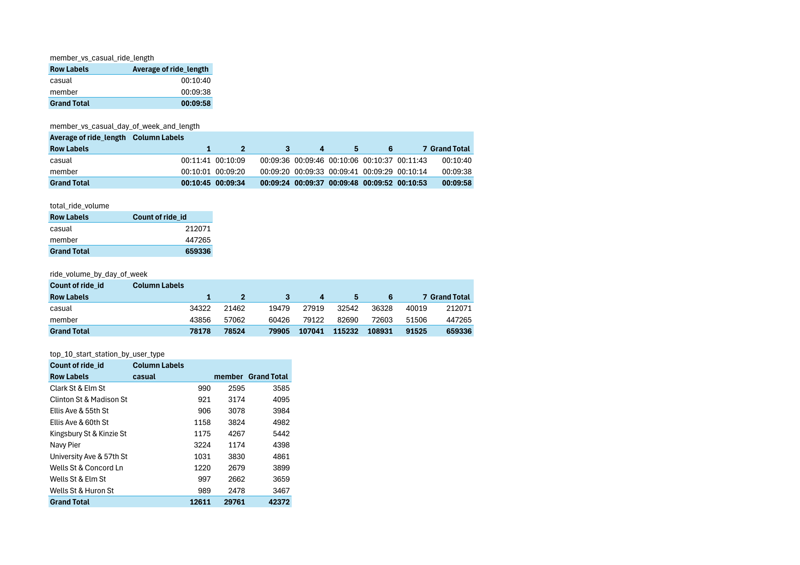

# Browsable data samples

## Files

| Folder | File | Description |
|---|---|---|
| `raw/` | `2025-04.csv` | Raw April 2025 excerpt |
| `raw/` | `2025-10.csv` | Raw October 2025 excerpt |
| `cleaned/` | `2025-04.csv` | Cleaned April 2025 excerpt |
| `cleaned/` | `2025-10.csv` | Cleaned October 2025 excerpt |

## Notes on interpreting the samples

- These are purely samples, and nowhere near the entire spreadsheet (which includes 600,000+ rows).
- The raw and cleaned excerpts are from the same named months, but not necessarily the same rows shown (as some would have been removed in the cleaning process.
- In the raw samples, `started_at` and `ended_at` appear as time-only values (for example, `29:34.6`). The date is not visible, though it is present which is how the `day of the week` columns were produced.
- Missing station values are represented as blank in the raw October excerpt and as `Missing` in the cleaned October excerpt.
  
## Reasoning for cleaning
- **Removing rows**: Some rows would have had start/end stations that were unidentifiable rather than just being missing, which would make said data harder to factor in. Removing these rows proved to keep data clean and reliable whilst not impacting analysis too harshly.
- **Fixing time formatting**: Times appeared as random numbers to readers, so putting them into a 24 hour format allowed for easier interpretation.
- **Latitude and longitude**: These have been restricted to 4 decimal places, allowing a standardised format across the spreadsheet whilst not compromising geographical accuracy. Whilst not visible, there were apostrophes at the start of some of these values, which have been removed.
- **Filling blanks in**: Where there were blanks, the word "Missing" was filled in instead. This allowed the useful data from the row to be used whilst not impacting final calculations like mean or mode.

## Combined data and PivotTables
 
- These tables were produced from combined April and October data.

